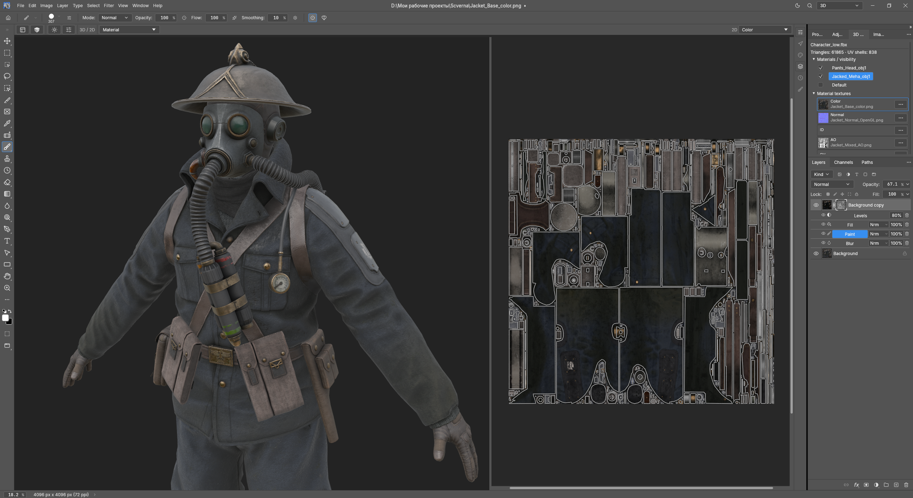
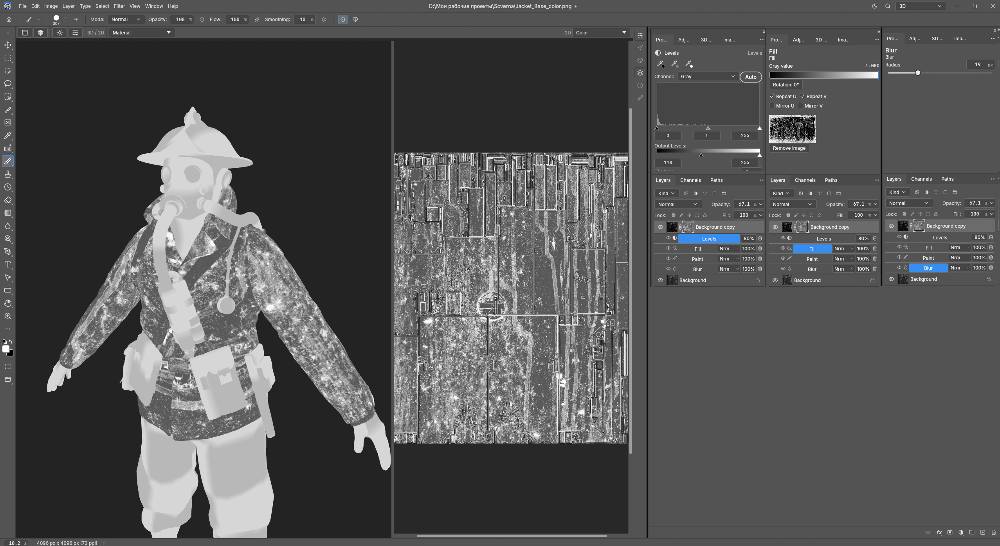

# PhotoCraft 3D / UV

[English](README.md) · [Скачать Windows-пакеты](https://github.com/veteraros-ai/photocraft-3d-uv/releases/latest)

Рабочая среда для рисования по 3D-моделям и работы с UV в [PhotoCraft](https://github.com/storytold/photocraft). Текущий исходный снимок рассчитан на PhotoCraft **0.17.0**; обратимый установочный пакет предназначен для **PhotoCraft 0.14.0, Windows x64**. Интерфейс доработки поддерживает русский и английский языки.

Это независимая доработка сообщества. Скачайте [portable ZIP для Windows x64](https://github.com/veteraros-ai/photocraft-3d-uv/releases/tag/v0.17.0-uv.1) версии 0.17.0 и запускайте программу из распакованной папки: она не заменяет установленную версию. Интерфейс программы поддерживает английский и русский языки; в архиве есть краткие инструкции на обоих языках. Старый обратимый установщик остаётся для PhotoCraft 0.14.0. Подробнее: [исходники и сборка 0.17.0](docs/CURRENT-SOURCE.md).

## Запуск portable-сборки PhotoCraft 0.17.0

1. Скачайте [portable ZIP](https://github.com/veteraros-ai/photocraft-3d-uv/releases/tag/v0.17.0-uv.1) и распакуйте весь архив в доступную для записи папку. В приложении можно выбрать английский или русский язык.
2. Запустите `photocraft.exe` из распакованной папки и выберите среду **3D**.
3. Язык интерфейса меняется в **Edit > Preferences > Interface > Language**.

Файл-маркер portable-режима сохраняет настройки и проекты этой сборки в `PhotoCraftData` рядом с программой, отдельно от профиля установленного PhotoCraft. ZIP не заменяет установленный EXE. Оставьте содержимое архива вместе, чтобы программа находила CLI-компаньон, уведомления, шрифты и лицензии.

## Скриншоты

Скриншоты относятся к исходной сборке PhotoCraft 0.17.0. [Полная презентация](docs/UV-WORKBENCH-0.17.0.md) содержит дополнительные сведения и информацию об источнике изображений.

### Обзор среды

### Подслои маски

### Каркас полигонов

### Выделение модели

## Возможности

- Импорт FBX (binary 7.4+) и OBJ, материалы, подключение текстур, скрытие материалов и уведомления для ReImport.
- GPU-вьюпорт, управление как в Maya, перспектива и ортографический вид, центр вращения на поверхности, конфигурации 3D/2D.
- UV-шеллы в редакторе, выделение прямоугольником и настраиваемые отступы от швов.
- Кистевые инструменты по модели, Paint UV / Paint Wrap, штамп и пипетка.
- Material и просмотр карт без освещения: Color, Normal, ID, AO, Curvature, Opacity, Metallic, Roughness, Emissive.
- Отключаемое PBR-освещение, HDR/EXR-окружение, просмотр маски на модели.
- Контейнер `.pcuv`: модель, текстуры со слоями, подключения, настройки сцены, окружение и библиотека изображений. **Export Textures** отдельно экспортирует плоские карты.
- Изолированная среда 3D с собственными документами.

## Установка

1. Установите [официальный PhotoCraft 0.14.0](https://github.com/storytold/photocraft/releases/tag/v0.14.0), сохраните работу и закройте программу.
2. Скачайте EN или RU ZIP из [релиза PhotoCraft 0.14.0](https://github.com/veteraros-ai/photocraft-3d-uv/releases/tag/v0.14.0-uv.3). Программа в обоих архивах одинаковая и поддерживает оба языка; отличается язык README.
3. Распакуйте весь архив в постоянную папку. Запустите `Install-3D-UV.cmd` от имени администратора, если установка в Program Files требует этих прав.
4. Открывайте PhotoCraft обычным ярлыком или через ArtCraft Launcher. Выберите рабочую среду **3D**.

Настройки языка и остальные предпочтения сохраняются. Для возврата к официальной программе используйте `Restore-Official.cmd`; сохраните папку `Backups`.

Известные предыдущие наши сборки обновляются напрямую, если рядом находится старый пакет с проверенной резервной копией официального EXE. Сохраните старый пакет. Если он находится в другом месте, передайте `-PreviousPackageDirectory "путь к старому пакету"` в `Install-Mod.ps1`. Установщик сохраняет официальный EXE и предыдущую доработку. Неизвестные сборки отклоняются даже при совпадении номера версии. Для новой версии PhotoCraft требуется новый совместимый пакет.

[Подробная инструкция](docs/INSTALL.ru.md) · [English installation guide](docs/INSTALL.en.md)

## Исходники и сборка

Текущий патч `source/photocraft-uv-0.17.0.patch` применяется к коммиту upstream `5f9b4391874aabc9deb2fcb905267613e4d93ec8` и соответствует исходнику `aed4caa4a754e9ffd42e1cd2709c8c92679acccd`. Инструкции по сборке приведены в [English README](README.md#build-the-current-photocraft-0170-source) и [заметках об исходниках 0.17.0](docs/CURRENT-SOURCE.md). Предыдущий снимок `source/photocraft-uv-0.16.0.patch` сохранён; старый `source/photocraft-uv.patch` используется историческими установочными пакетами для PhotoCraft 0.14.0. `release-manifest.json` описывает только исторические установщики для PhotoCraft 0.14.0; текущий источник версии 0.17.0 описан в `source/current-source.json`.

Установщик находится в `installer/`, документация — в `docs/`, контрольные суммы — в `release-manifest.json` и файле `SHA256SUMS.txt` релиза. Готовые EXE распространяются в Releases. Пользовательские сцены, настройки, рабочие модели и кэши не включены.

Исходники распространяются на условиях MIT OR Apache-2.0 с сохранением лицензий PhotoCraft. См. LICENSE-MIT, LICENSE-APACHE, ATTRIBUTION.md и source/LICENSE-uv-icons.txt. Это не официальный релиз PhotoCraft.
